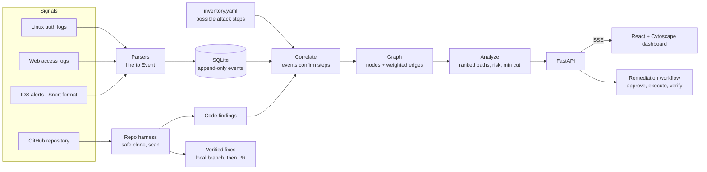
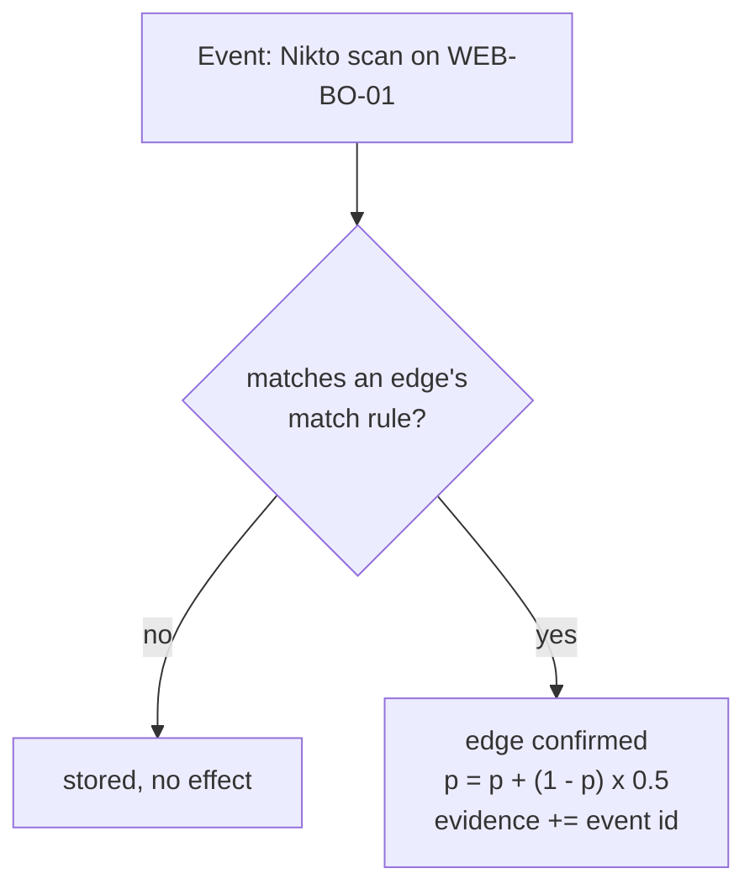
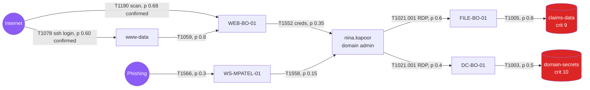
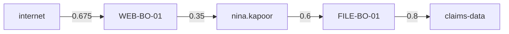
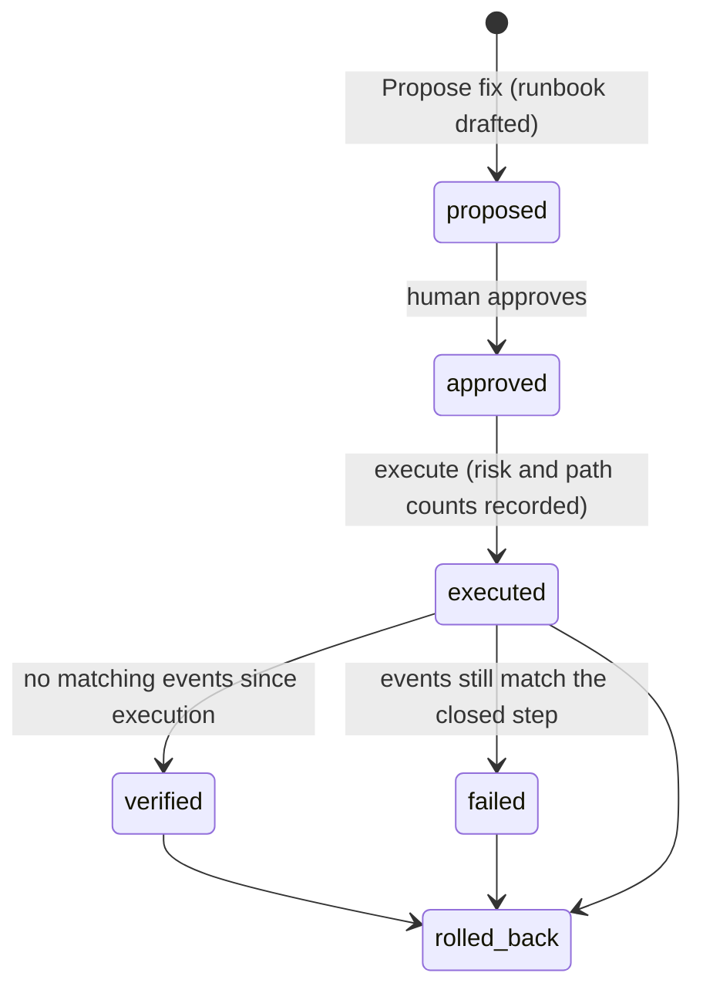
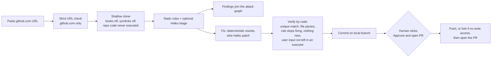
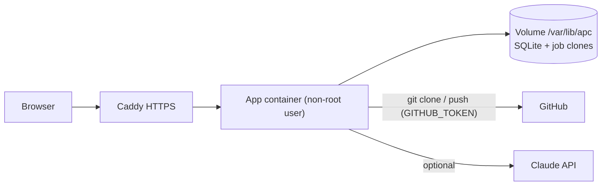
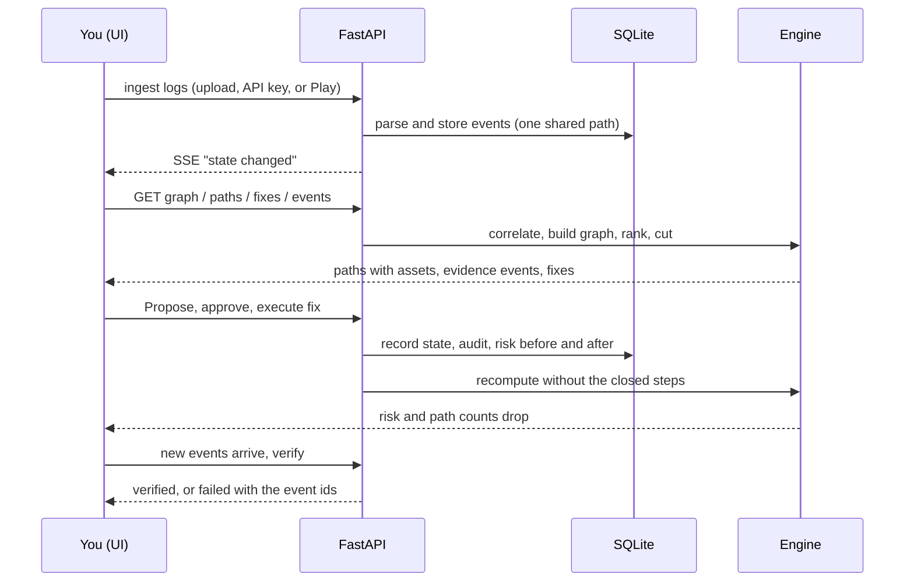

# How the Attack Path Compiler works

One idea: **small signals in, one explained attack path out, the cheapest fix that stops it, and proof it worked.**
All data is synthetic. Status notes at the bottom say what is and is not finished.

## 1. The big picture



## 2. Two sources of truth

| Source | Says | Example |
|---|---|---|
| `inventory.yaml` | what **could** happen: possible steps with a prior probability and a fix cost | WEB-BO-01 could leak nina.kapoor's credentials, p = 0.35 |
| Logs (and code findings) | what **is** happening or exposed | a Nikto scan against WEB-BO-01 at 13:00 |

When an event matches a possible step, the step becomes **confirmed**, its probability rises, and the event id
is attached as evidence. **With no events and no code findings there is nothing to analyse, so the system
reports no paths and zero risk** (prior probabilities alone are not evidence).



## 3. The graph it builds

Circles are things (internet, hosts, identities, data). Arrows are attack steps with a technique id.
Amber arrows are confirmed by events; grey ones are possible only.



Findings from a scanned repo (hard-coded secret, SQL injection, shell execution...) are added to the same graph
as nodes and edges, so code weaknesses and log activity are ranked together.

## 4. Ranking paths: likelihood x impact

A **path** runs from an external entry point to a crown-jewel data node.

```
risk = (p1 x p2 x ... x pn) x criticality of the target / 10
```

Worked example (the live demo's top path after two events):



`0.675 x 0.35 x 0.6 x 0.8 x 9/10 = 0.102`, rated HIGH. The first hop rose from its prior 0.35 to 0.675 because
one event confirmed it.

How the search works:
1. Weight each step `w = -log(p)`, so the **most likely** route is the **shortest** route.
2. Take the `k x 4` likeliest candidates (k-shortest simple paths, 2 second time budget).
3. **Re-rank by risk**, because a slightly less likely route to a more critical asset can matter more.

Severity: CRITICAL >= 0.30, HIGH >= 0.10, MEDIUM >= 0.03, otherwise LOW.

## 5. Finding the cheapest fix

Every arrow has a **remediation cost**. We want the cheapest set of arrows to remove so that **no dangerous path
survives**. That is a minimum cut.


- Cutting `WEB -> NINA` (cost 4) breaks everything downstream.
- That beats cutting `NINA -> FILE` and `NINA -> DC` (5 + 8 = 13).
- A cut that only minimises the **number** of edges can pick a costlier fix, so we minimise **cost**, and show
  the count-based cost as a baseline.
- Steps with no cost (for example "this workstation is this person") are never cut.

| Fix | Meaning |
|---|---|
| Cheapest cut | minimum total cost that breaks all dangerous paths (min cut) |
| Best single fix | the one step whose removal takes away the most risk |

Each fix carries its ATT&CK mitigation, for example `T1552 -> M1027 Password Policies`.

## 6. From fix to proof: the remediation workflow

A recommended fix is not "applied" with one click. It goes through a controlled lifecycle with an audit trail.



- **Verify is real:** it passes only if the step is closed *and* no event ingested after execution still
  matches it. If the attacker is still active, the state becomes `failed` and names the event ids.
- **Before and after:** execution records risk and the number of dangerous paths before and after.
- **Runbook:** a template per ATT&CK mitigation; optionally rewritten by Claude Haiku from the same facts.

## 7. Repo harness: from a GitHub URL to a pull request



- Rule fixes are deterministic (weak hash, TLS off, `yaml.load`, debug mode, hard-coded secret, plain-HTTP
  script, `target=_blank`).
- Haiku may draft a patch for harder cases such as SQL built from strings. If the whole command comes from user
  input it must answer `cannot_fix`, and the issue stays a finding for a human.
- The PR body lists each fix with CWE and ATT&CK ids, flags AI-drafted patches for careful review, and states
  that **tests were not run**.
- Repos with nothing scannable or no findings say so explicitly instead of ending silently.

### How it works once deployed



- The app runs **inside its own container** and works on a **temporary clone** under `DATA_DIR/jobs/<id>/repo`
  on the volume. It never edits your laptop or the original repository; the only way a change leaves the server
  is a branch push and a pull request that a human opens.
- It needs `git` (included in the image), outbound HTTPS to github.com, and a `GITHUB_TOKEN` in server env
  (read for private repos, write to push the branch and open the PR). Without a token you still get the diff and a
  patch download.
- A PR is always attributed to the token's owner. A multi-user deployment should use a GitHub App or per-user
  OAuth instead of one shared token; that is not built yet.
- Clones older than 24 hours are deleted when a new job starts, and each user has one running job at a time.
- Every fix lists the checks it passed (unique edit, file still parses, rule stopped matching, no new findings,
  no user input left in an executor), and the job re-verifies the files **on disk** before committing. Only
  Python, JSON and YAML are syntax-checked; other file types are labelled "not syntax-checked".

## 8. What happens on each action



Nothing is hardcoded: the UI shows whatever the engine computes from what you ingested or scanned.

## 9. What the dashboard shows

| Area | Content |
|---|---|
| Graph | possible and confirmed steps, selected path highlighted |
| Paths | ranked list with severity |
| Path detail | story, **affected assets**, kill-chain bar, per-hop technique, **contributing events**, mitigation |
| Events | the ingested security events |
| Insights | events to confirmed steps to ranked paths, **attack timeline**, **risk over time**, **before and after** |
| Remediation workflow | proposed to verified, runbook, audit trail |
| Repo | scan a GitHub repo, review the diff, download the patch, approve and open the PR |

A fresh demo session opens empty on purpose: nothing is shown until you bring data in.

## 10. How the four objectives map

| Objective | Where |
|---|---|
| 1. Multi-source event correlation | Ingest and Events tabs, parsers, `correlate.py` |
| 2. Risk analysis and optimal remediation | Paths, Recommended fixes, Insights before/after |
| 3. Interactive dashboard | Graph, Paths, Events, Insights |
| 4. Explainable analysis and remediation lifecycle | Path detail, Remediation workflow, Repo harness |

## 11. Where things live

| Piece | File |
|---|---|
| Event / Node / Edge shapes | `backend/app/models.py`, `docs/contracts.md` |
| Log parsers | `backend/app/parsers/` |
| Event confirms edge | `backend/app/correlate.py` |
| Paths, risk, min cut | `backend/app/analyze.py` |
| Snapshot, timeline, risk series | `backend/app/engine.py` |
| Story, evidence per hop | `backend/app/narrate.py` |
| Remediation lifecycle | `backend/app/remediation.py` |
| Code rules and triage | `backend/app/codescan.py` |
| Fix generation and checks | `backend/app/fixers.py` |
| Repo harness and PR | `backend/app/harness.py` |
| Optional AI calls | `backend/app/ai.py` |
| Possible attack steps | `data/inventory.yaml` |
| ATT&CK names and mitigations | `data/attack_subset.json` |
| API | `backend/app/main.py` and the `*_api.py` routers |
| UI | `frontend/src/` |
| Objectives, plan, benchmarks | `docs/OBJECTIVES.md`, `docs/MASTER_PLAN.md`, `docs/BENCHMARKS.md` |

## 12. What is deterministic and what is AI

| Step | How it is decided |
|---|---|
| Parsing, correlation, probabilities | code |
| Path ranking, risk, min cut | code (networkx), unit-tested |
| Which step to cut | code |
| Runbook wording | template; optionally Claude Haiku |
| Judging a code finding exploitable | static rule; optionally Claude Haiku |
| Drafting a hard patch | optionally Claude Haiku, then code must verify it |
| Applying a fix, opening a PR | a human |

The system works end to end with no AI key and no GitHub token; those add triage, drafting and PR delivery.

## 13. Honest status

- **Not yet generated:** the EvidenceForge sample logs. Until they are committed, the Play button stays hidden
  and the dashboard opens empty.
- **Not yet deployed:** it runs locally in Docker; the VPS, HTTPS and Supabase auth are pending.
- **Limits:** rules are regex-level (no data-flow analysis); "verified" means the issue pattern is gone, not
  that the code is proven secure; repo patches are not test-run, so a human reviews each PR.
- **Verified live:** a real GitHub repo scan produced a real pull request with correctly parameterised SQL,
  `safe_load`, environment-based secret and HTTPS script source; an unsafe shell-injection patch was
  rejected and left for a human.
