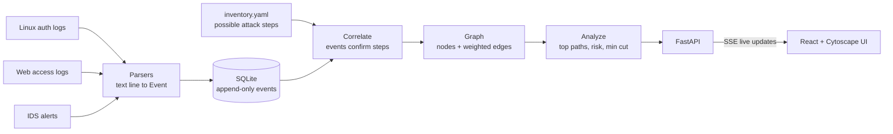
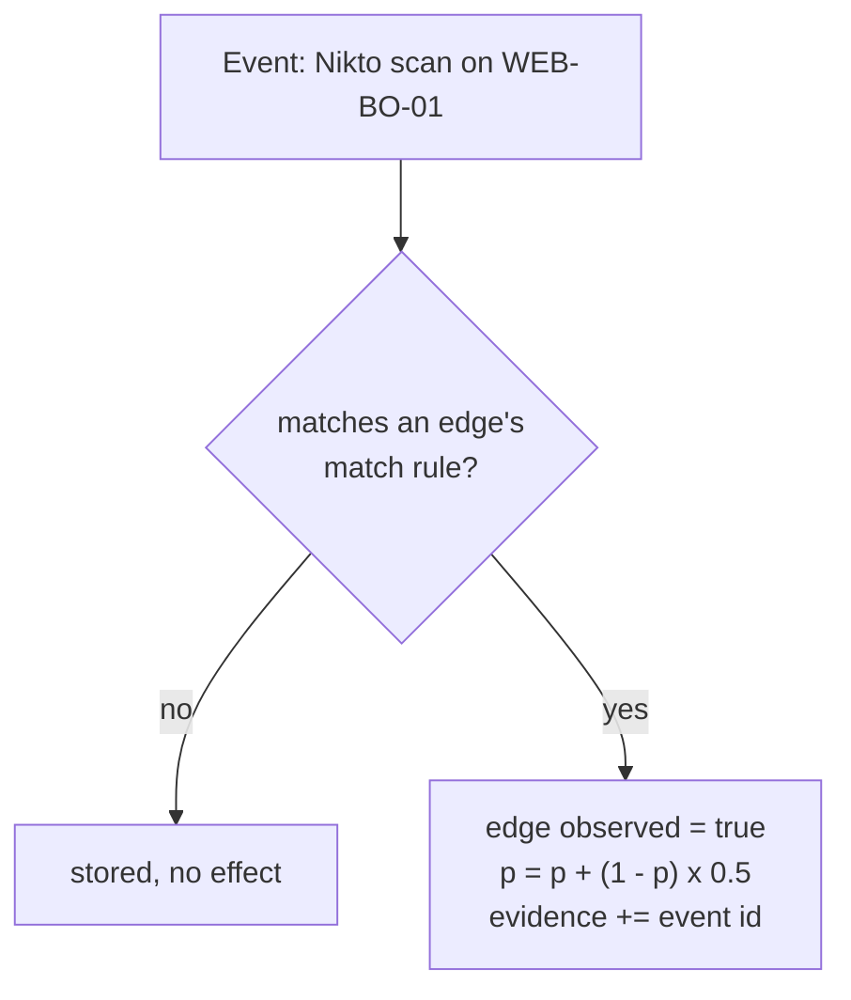
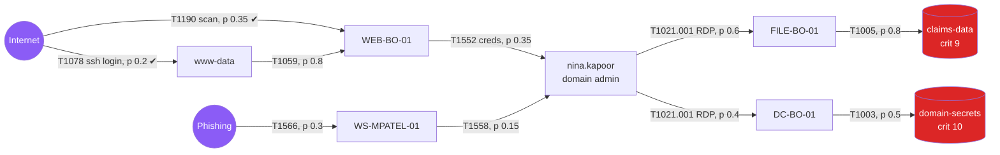
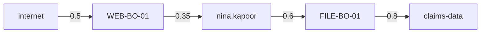
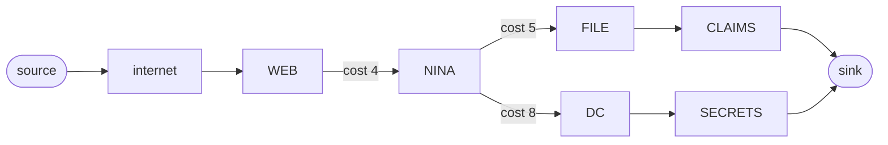
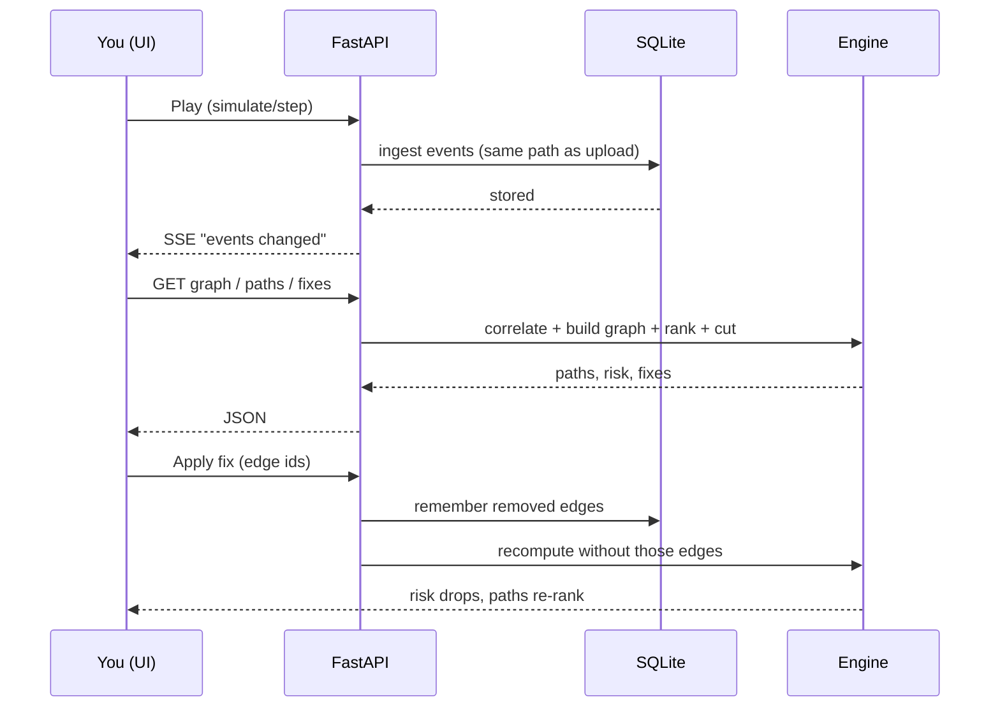

# How the Attack Path Compiler works

One idea: **small alerts in, one attack path out, and the cheapest fix that stops it.**
All data is synthetic.

## 1. The big picture



## 2. Two sources of truth

| Source | Says | Example |
|---|---|---|
| `inventory.yaml` | what **could** happen (possible steps, prior probability, fix cost) | WEB-BO-01 could leak nina.kapoor's credentials, p = 0.35 |
| Logs | what **is** happening | Nikto scan against WEB-BO-01 at 13:00 |

When a log event matches a possible step, that step becomes **observed**,
its probability goes up, and the event id is attached as evidence.



## 3. The graph it builds

Circles are things (internet, hosts, identities, data). Arrows are attack steps.
Amber = confirmed by events. Grey = prior only.



## 4. Ranking paths: likelihood x impact

A **path** runs from an external entry point to a crown-jewel data node.

```
risk = (p1 x p2 x ... x pn) x criticality of the target / 10
```

Example top path from the demo:



`0.5 x 0.35 x 0.6 x 0.8 x 9/10 = 0.076` (the first hop is raised from 0.35 because an event confirmed it).

Search uses `w = -log(p)` so the **most likely** path is the **shortest** path
(k shortest simple paths in networkx). Severity bands: CRITICAL >= 0.30, HIGH >= 0.10, MEDIUM >= 0.03, else LOW.

## 5. Finding the cheapest fix

Every arrow has a **remediation cost** (for example "enforce MFA" = 5).
We want the cheapest set of arrows to remove so **no dangerous path survives**. That is a minimum cut.



- Cutting `WEB -> NINA` (cost 4) breaks everything downstream.
- Cheaper than cutting `NINA -> FILE` and `NINA -> DC` (5 + 8 = 13).
- A cut that only minimises the **number** of edges can pick a costlier fix. We use cost, not count.
- Edges with no cost (for example "this host is this identity") can never be cut.

Two answers are shown:

| Fix | Meaning |
|---|---|
| Cheapest cut | min total cost that breaks all dangerous paths (min cut) |
| Best single fix | the one edge that removes the most risk |

Each fix is labelled with its ATT&CK mitigation, for example `T1552 -> M1027 Password Policies`.

## 6. What happens when you press Play / Apply fix



Nothing is hardcoded: the UI shows whatever the engine computes from the events you ingested.

## 7. Where things live

| Piece | File |
|---|---|
| Event / Node / Edge shapes | `backend/app/models.py`, `docs/contracts.md` |
| Log parsers | `backend/app/parsers/` |
| Event confirms edge | `backend/app/correlate.py` |
| Paths, risk, min cut | `backend/app/analyze.py` |
| Story per path | `backend/app/narrate.py` |
| Possible attack steps | `data/inventory.yaml` |
| ATT&CK names + mitigations | `data/attack_subset.json` |
| API | `backend/app/main.py` |
| UI | `frontend/src/` |
