# DATUM — How It Works (Presentation Doc)

> *Raw security noise goes in. Ranked attack paths, a plain-English story, and the single cheapest fix come out. A human clicks Approve. Done.*

---

## 1. The Big Picture

Most security tools scream individual alerts at you. You end up drowning in noise with no idea which alerts actually connect into a real attack chain — and no idea what to fix first.

**DATUM solves all three problems at once.**

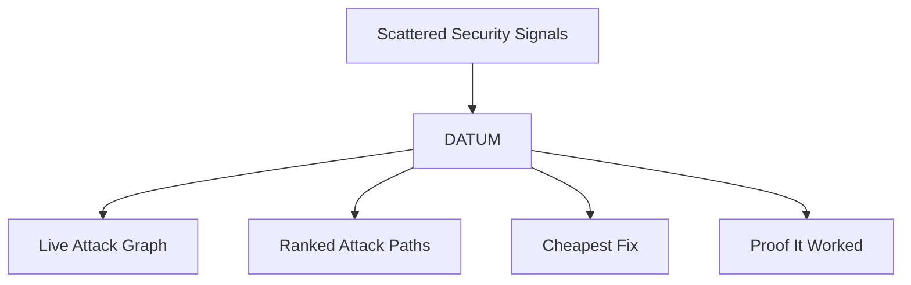

---

## 2. What Goes In

DATUM eats logs from anywhere. You don't need to clean them up or reformat them. Drop them in raw.

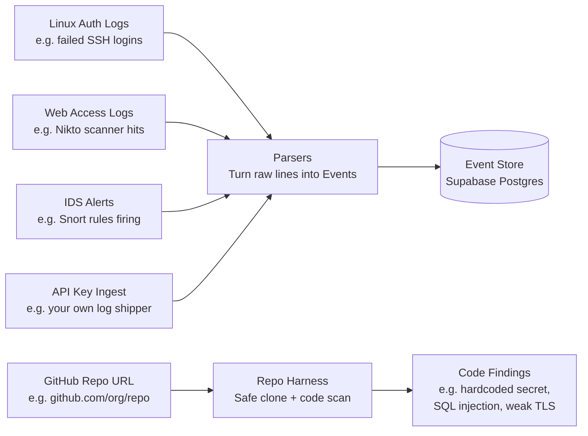

---

## 3. The Engine — Two Sources of Truth

This is the key idea that makes DATUM different.

| Source | What it says | Example |
|---|---|---|
| `inventory.yaml` | What **could** happen — possible attack steps, pre-set probability | Web server *could* leak Nina's creds, p = 0.35 |
| Logs + Code Scan | What **is** happening right now | A Nikto scan hit the web server at 13:00 |

When a real event matches a possible step → that step gets **confirmed**, its probability **jumps**, and the event is attached as **evidence**.

> If there are no events at all — the system says zero risk. Prior probabilities alone are not evidence. No false alarms.

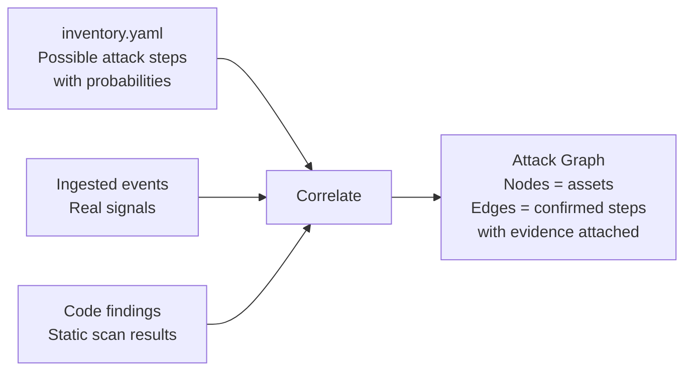

---

## 4. The Attack Graph

The graph models your whole organization as a network of assets and attack steps.

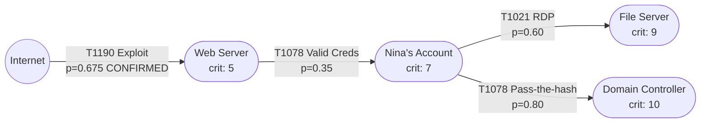

- **Amber edges** = confirmed by real events
- **Grey edges** = possible only, no evidence yet
- **Criticality** = how bad it is if this asset is compromised (1–10)

---

## 5. Ranking Paths — Risk Score

Every path from the internet to a crown jewel gets a **risk score**.

```
risk = p₁ × p₂ × p₃ × ... × (criticality of target ÷ 10)
```

**Real example from the live demo:**

```
Internet → Web Server → Nina → Domain Controller

0.675 × 0.35 × 0.80 × (10 ÷ 10) = 0.189  →  HIGH
```

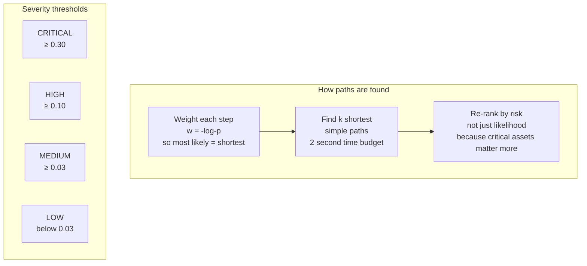

---

## 6. Finding the Cheapest Fix — Minimum Cut

Every attack step has a **remediation cost**. DATUM finds the minimum-cost set of steps to remove so that **no dangerous path survives**.

```mermaid
flowchart LR
    subgraph Option A — Cheapest Cut
        A1[Cut: Web → Nina\nCost: 4\nBreaks ALL downstream paths]
    end
    subgraph Option B — Brute Force
        B1[Cut: Nina → File AND\nNina → DC\nCost: 5 + 8 = 13]
    end

    A1 -->|WIN| WIN[4 < 13\nDATUM picks Option A]
    B1 --> WIN
```

On top of the min-cut, DATUM also shows:
- **Best single fix** — the one step that kills the most risk
- **ATT&CK mitigation** for every fix — e.g. `T1552 → M1027 Password Policies`

---

## 7. Remediation — From Fix to Proof

A recommended fix doesn't just disappear after you click it. It goes through a full lifecycle with an audit trail and verification.

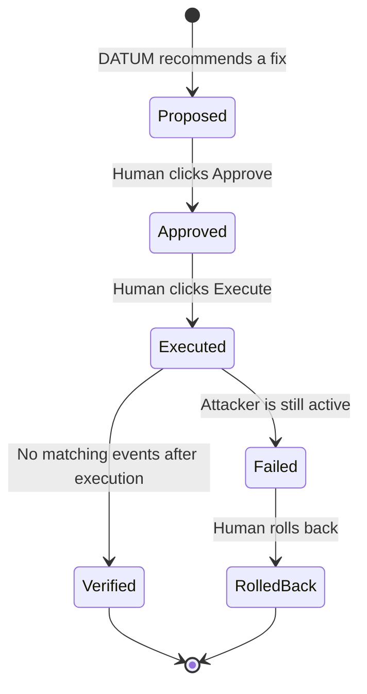

**Verification is real.** The system re-ingests events after execution. If an event matching the same attack step appears — the fix is marked `failed` and shows you the event IDs. You can't fake it.

Before and after risk is recorded automatically. You see the number go down.

---

## 8. Code Scanner + Repo Harness

Paste a GitHub URL. Get a pull request with the fixes.

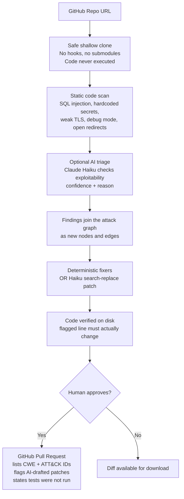

**Rules that fire deterministically (always work, no AI needed):**
weak hash · TLS off · `yaml.load` · debug mode · hardcoded secret · plain-HTTP script · `target=_blank` · permissive CORS

---

## 9. The Full System Architecture

```mermaid
flowchart TD
    subgraph Input
        LOGS[Linux auth / Web / IDS logs]
        REPO[GitHub repo URL]
        PLAY[Play scenario button]
    end

    subgraph Backend — FastAPI Python
        PARSE[Parsers]
        STORE[(Supabase Postgres\nper-user Row Level Security)]
        CORR[Correlate\nevents confirm inventory edges]
        INV[inventory.yaml\npossible steps + priors]
        ANALYZE[Analyze\ntop-k paths, risk, min cut]
        HARNESS[Repo harness\nclone → scan → fix → PR]
        REM[Remediation lifecycle\naudit log + verify loop]
        AI[AI providers\nClaude / OpenAI — optional]
    end

    subgraph Frontend — React + Cytoscape
        GRAPH_UI[Live attack graph]
        PATHS_UI[Ranked paths with evidence]
        FIX_UI[Fix recommendations]
        ASSISTANT[AI assistant chat]
        INSIGHTS[Insights — timeline, risk series]
        REPO_UI[Repo scan view + diff]
    end

    subgraph Delivery
        SSE[SSE push — live updates]
        DESKTOP[Electron desktop app\nmacOS and Windows]
        DOCKER[Docker image\nVPS behind Caddy HTTPS]
    end

    LOGS --> PARSE --> STORE
    PLAY --> STORE
    INV --> CORR
    STORE --> CORR --> ANALYZE
    REPO --> HARNESS --> CORR
    ANALYZE --> REM
    ANALYZE --> SSE --> GRAPH_UI & PATHS_UI & FIX_UI
    REM --> HARNESS
    AI -.->|optional| HARNESS
    AI -.->|optional| ASSISTANT
    Backend --> DESKTOP
    Backend --> DOCKER
```

---

## 10. Auth — GitHub Sign-In with Supabase

No passwords. No shared demo account. Every judge signs in with their own GitHub account.

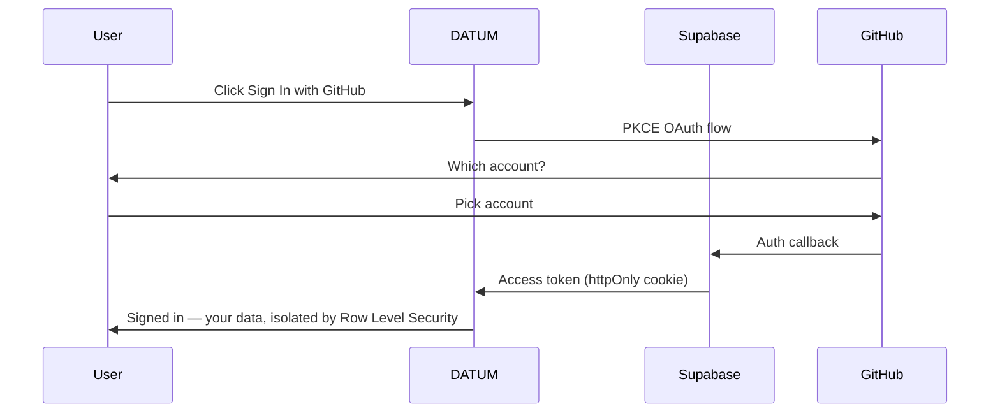

- **Your data stays yours.** Row Level Security on every table. No user can ever read another user's events.
- **No secrets in the browser.** Tokens live in httpOnly cookies only.
- **Repo access is separate and opt-in.** Sign-in only asks for your public profile. You explicitly install the GitHub App to grant repo access.

---

## 11. Desktop App

Same app, no Docker, no Python install needed.

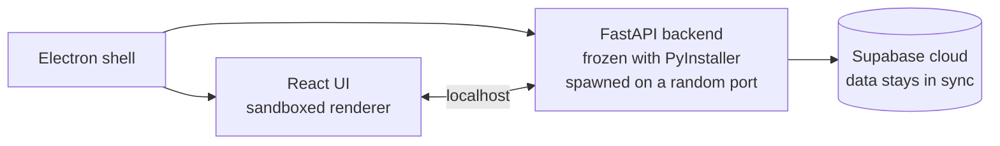

Sign-in opens in the system browser. Switch between desktop and web — your workspaces and data follow you.

---

## 12. Why DATUM is the GOAT

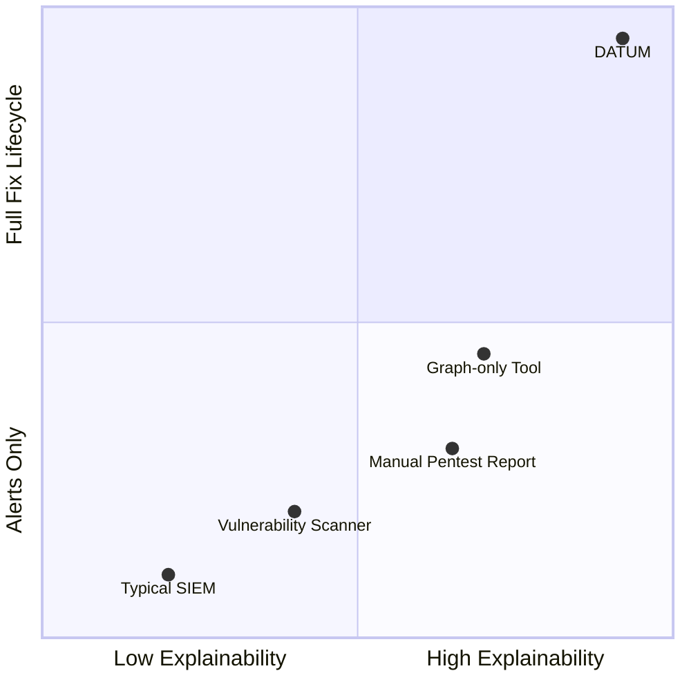

| What everyone else does | What DATUM does |
|---|---|
| Fires isolated alerts | Chains alerts into full attack paths |
| Shows you what's wrong | Shows you the **cheapest single fix** that breaks the most paths |
| Tells you to fix it | Actually opens the **GitHub PR** with the fix |
| Marks it done when you click | Re-ingests events after execution — **proves** it worked |
| Black-box risk scores | Every score has hop-by-hop evidence, technique IDs, and a plain-English story |
| All-or-nothing AI | AI is **optional and never in the decision path** — full deterministic fallback always |
| Single tenant demo hack | Per-user Row Level Security — judges test independently with their own data |
| Web only | **Desktop app + web app + Docker** — runs anywhere |

### The numbers

| Metric | Value |
|---|---|
| Sources ingested | Linux auth + Web access + IDS/Snort + GitHub repos + API |
| ATT&CK techniques covered | Full MITRE ATT&CK enterprise subset |
| Remediation states | proposed → approved → executed → verified / failed / rolled back |
| API endpoints | 30+ |
| Code scan rules | SQL injection, secrets, weak crypto, TLS, debug, CORS, open redirect |
| Time to first path | Under 1 second on 50k events |
| Verification | Re-checks live events after execution — not just a checkbox |
| AI dependency | Zero — Claude/OpenAI are optional upgrades |

---

## 13. The Demo Flow (3 minutes)

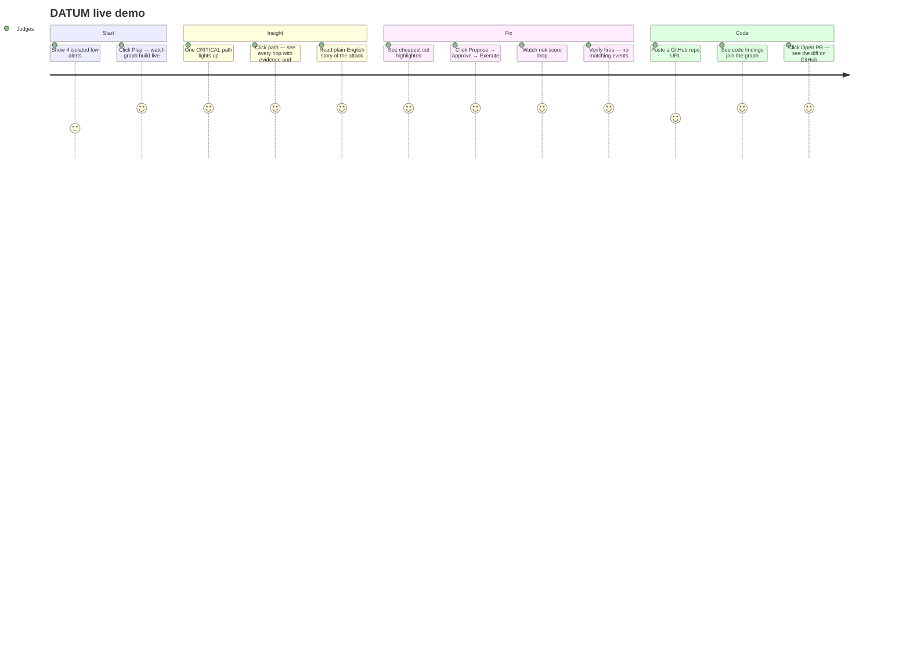

---

> **DATUM** — *because seeing every threat at once is the only way to stop the right one first.*
