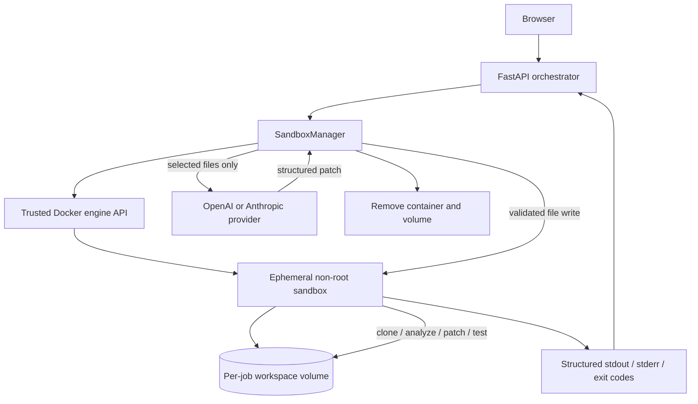

# Docker sandbox execution service

The sandbox package is infrastructure only. No route or current application workflow calls it yet.

## Architecture



The Docker socket is available only to the trusted orchestrator. It is never mounted in a sandbox.

## Lifecycle

1. Create a uniquely named, labelled Docker volume.
2. Start the runner with a minimal init process, read-only root filesystem, non-root UID/GID, no added capabilities, `no-new-privileges`, CPU/memory/PID limits, bounded `/tmp`, bridge networking, and no published ports. The init process reaps orphaned child processes created by repository commands until teardown.
3. Clone with hooks, submodules, symlinks, prompts, and the local Git transport disabled.
4. Execute explicit analysis commands and capture bounded stdout, stderr, exit status, and timeout state.
5. Read only requested, path-validated files for an orchestrator-side AI request.
6. Write a structured patch or replacement files back through path-validated APIs.
7. Execute explicit validation/test commands and collect results.
8. Force-remove the container and its workspace volume in `finally`, including timeout paths.

`cleanup_stale()` removes abandoned resources carrying the sandbox management labels.

## Public API

```python
from app.services.sandbox import SandboxManager

manager = SandboxManager()
with manager.session() as sandbox:
    clone = sandbox.clone("https://github.com/owner/repo.git")
    analysis = sandbox.run("python -m compileall .")
    selected = sandbox.read_file("src/example.py")
    # Call OpenAI or Anthropic in the orchestrator, then:
    sandbox.write_file("src/example.py", patched_bytes)
    tests = sandbox.run("python -m pytest -q")
```

`run_repository()` is a convenience method for non-interactive clone/analyze/test pipelines.

## Docker deployment

Build both images before enabling sandbox jobs:

```sh
docker compose -f docker-compose.yml -f docker-compose.sandbox.yml \
  --profile sandbox-build build apc-main sandbox-runner
docker compose -f docker-compose.yml -f docker-compose.sandbox.yml up -d caddy apc-main
```

The `sandbox-runner` Compose service is build-only and belongs to the `sandbox-build` profile. The optional override mounts the engine socket into the trusted orchestrator. Ordinary `docker compose up` continues to use the existing stack without sandbox wiring. The child receives neither that socket nor application/provider secrets.

Docker socket access is root-equivalent access to the engine and therefore belongs only in the trusted orchestrator. On Linux set `DOCKER_GID` to the socket group (`stat -c %g /var/run/docker.sock`). A remote, separately protected Docker engine is the preferred production evolution.

Configuration:

| Variable | Default | Meaning |
|---|---:|---|
| `SANDBOX_IMAGE` | `datum-sandbox:latest` | Runner image |
| `SANDBOX_CPUS` | `1.0` | CPU quota |
| `SANDBOX_MEMORY` | `1g` | Memory and swap ceiling |
| `SANDBOX_PIDS_LIMIT` | `256` | Process ceiling |
| `SANDBOX_TIMEOUT` | `300` | Per-command seconds |
| `SANDBOX_CLONE_TIMEOUT` | `120` | Clone seconds |
| `SANDBOX_TMPFS_SIZE` | `256m` | `/tmp` ceiling |
| `SANDBOX_NETWORK` | `bridge` | Non-host Docker network |
| `DOCKER_GID` | `0` | Supplemental group for the opt-in engine socket mount |

## Future integration points

- Repository harness: replace host clone/fix/test operations with a manager session.
- OpenAI/Anthropic: send extracted text from the orchestrator; write returned patches into the session.
- Scanner: execute repository tools in the session and translate `CommandResult` values into job logs.
- Test execution: map detected project types to explicit allowlisted commands.
- Policy: use a dedicated egress-filtered Docker network or remote sandbox engine before enabling untrusted public jobs.

## Verification

```sh
cd backend && python -m pytest -q tests/test_sandbox.py
docker build -f Dockerfile.sandbox -t datum-sandbox:latest .
docker run --rm --read-only --tmpfs /tmp --cap-drop ALL \
  --security-opt no-new-privileges:true --user 10001:10001 \
  datum-sandbox:latest id
```

The generic runner currently provides Git, Python 3, Node.js 22, and npm. Repositories requiring other runtimes need separately reviewed runner images; the manager API is image-agnostic.
