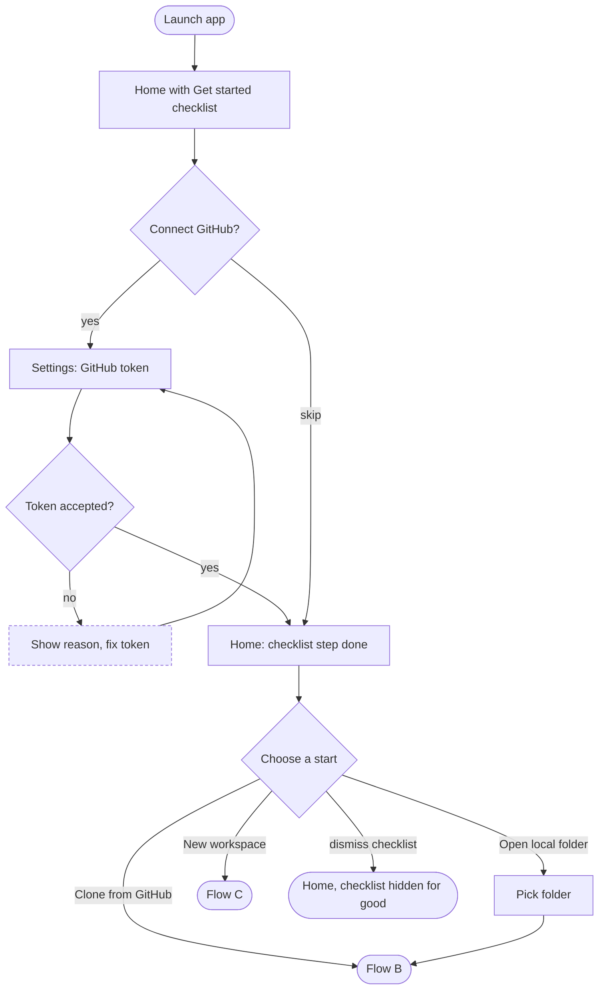
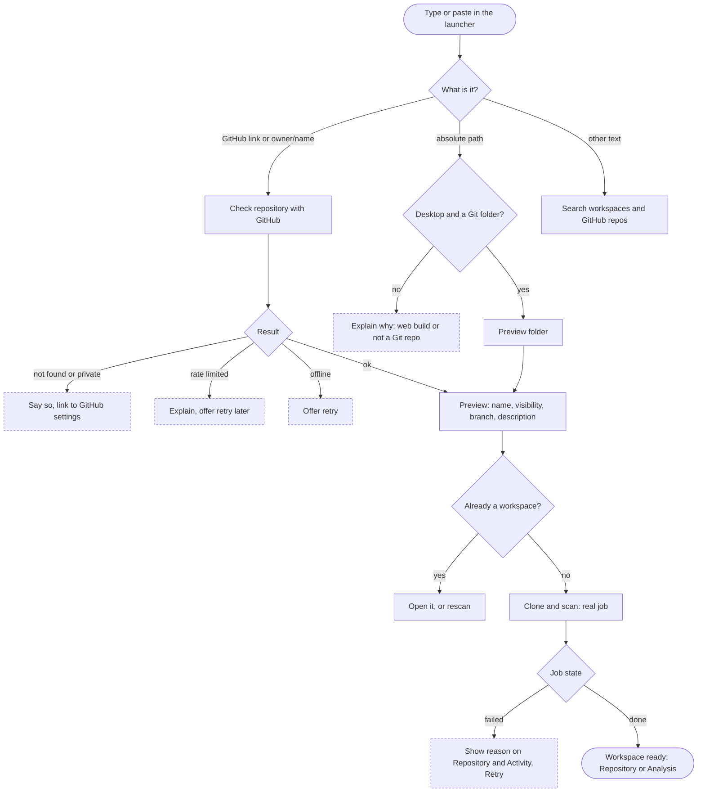
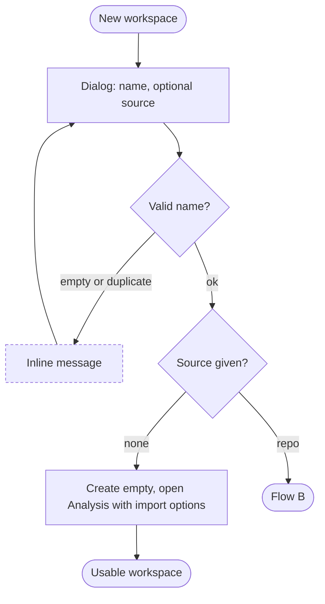
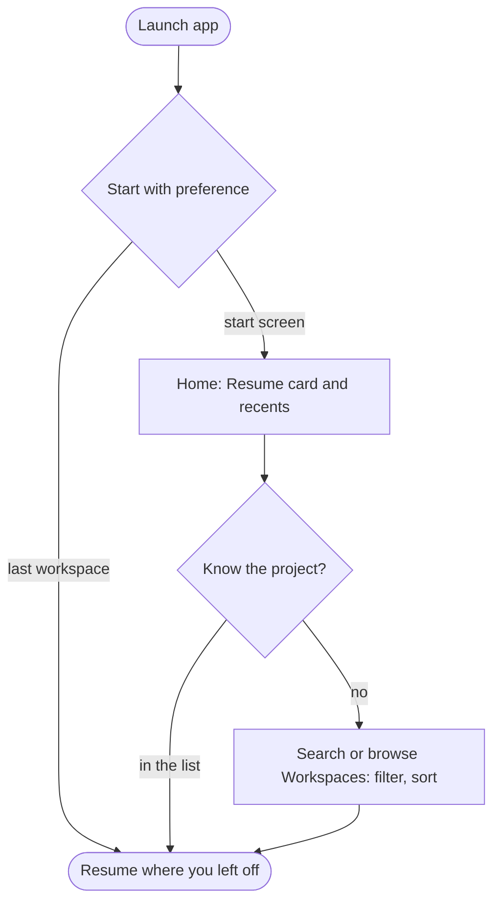
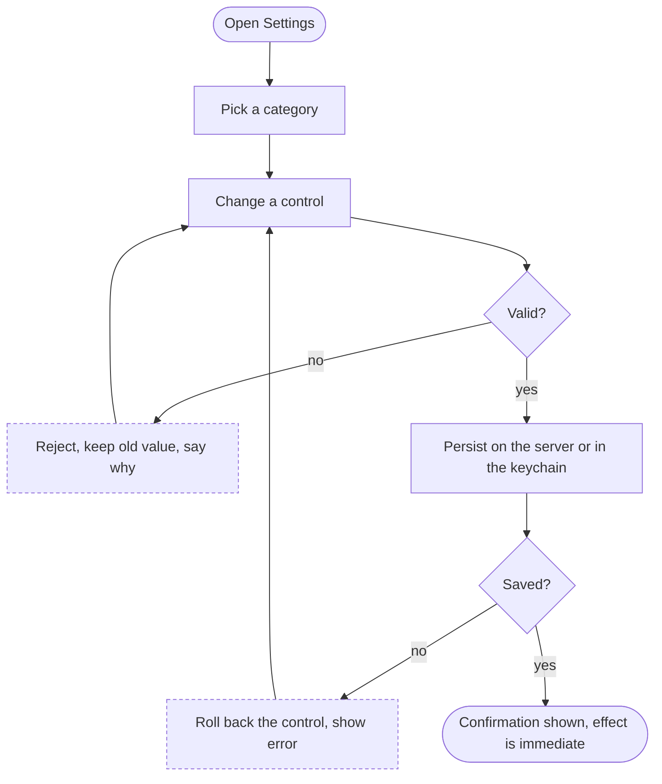
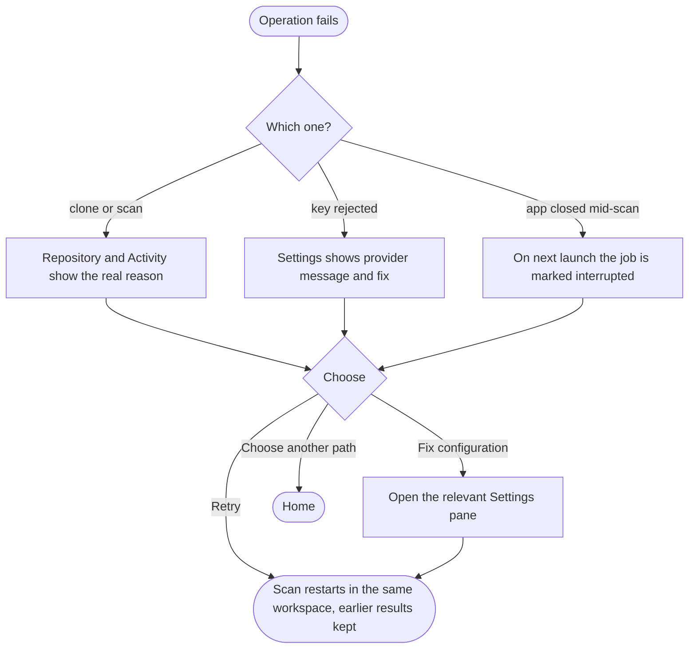

# User flows

Notation (per Figma's user-flow guidance): one goal per flow, explicit start and end, decisions as diamonds, the
same symbol for the same thing. Rounded = start/end, rectangle = screen or step, diamond = decision, dashed =
recovery. Each flow lists the gaps it exposed in the previous design and what was changed.

## Capability inventory (what actually exists, so only these get a door)

| Capability | Backend | Where it lives now |
|---|---|---|
| Workspaces (create, open, rename, delete, search, sort) | `workspaces.py` | Home, Workspaces, sidebar switcher |
| GitHub link → resolve → clone → scan | `github.py`, `harness.py` | Home launcher |
| Local Git folder → scan (desktop only) | `harness.py` (local clone) | Home launcher, File menu |
| Attack-path analysis, fixes, remediation | `engine.py`, `remediation.py` | Analysis |
| Repository findings, patches, pull request | `harness.py` | Repository |
| Metrics, timeline, benchmarks | `metrics.py` | Insights |
| AI assistant (Claude, OpenAI) | `providers/` | Assistant |
| Scan history and remediation audit trail | `jobs`, `audit` tables | Activity |
| Connected services and log ingestion keys | `keys.py`, `/api/keys` | Integrations |
| Preferences, keys, storage, diagnostics | `prefs.py`, `keys.py` | Settings |

Not built, therefore not shown: a file browser, an integrated terminal, an agent runner.

## A. First launch

Gaps closed: the old screen never said what the product does or what was optional. Nothing is forced: every
checklist step is skippable, and it disappears once dismissed or complete.

## B. Import a repository

Gaps closed: the old flow created the workspace on Enter with no preview, and a failed clone left no way back.

## C. Create a workspace

## D. Returning user

## E. Change a setting

## F. Recover from a failure

Existing work is never discarded by a failure: a failed scan keeps its workspace, events and history.
