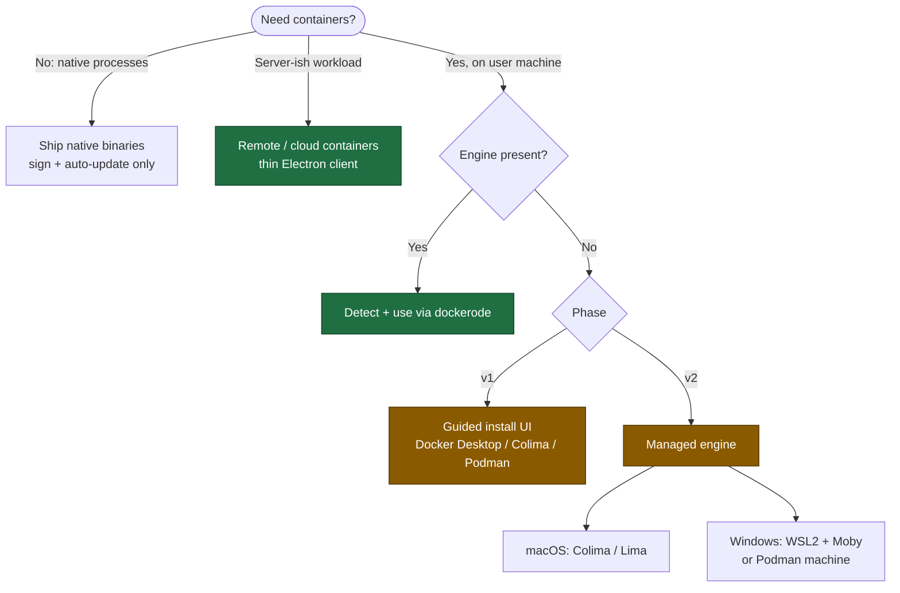
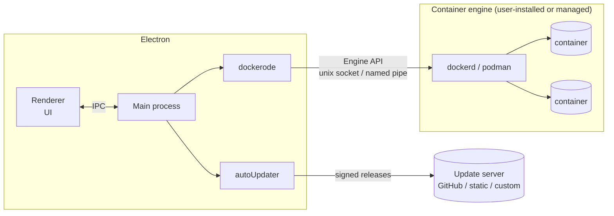
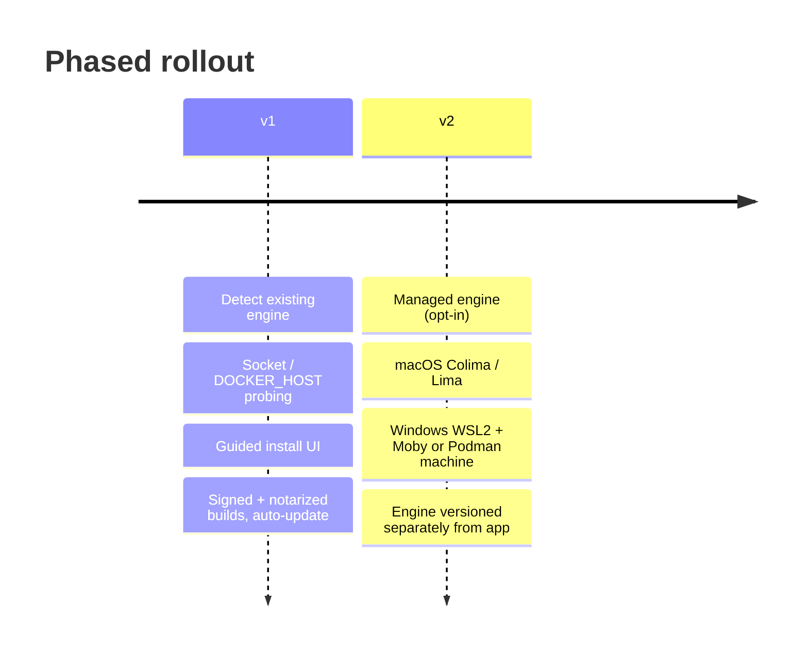
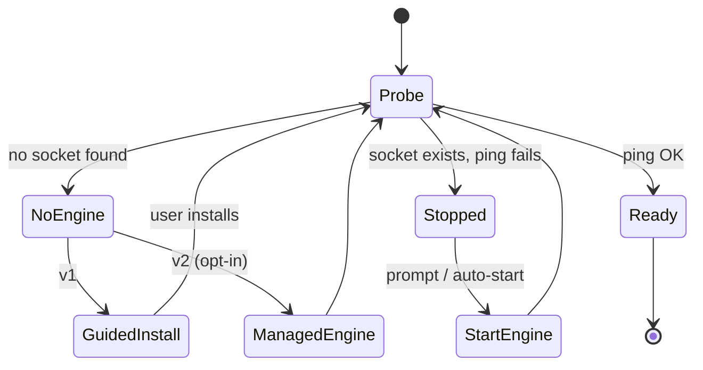
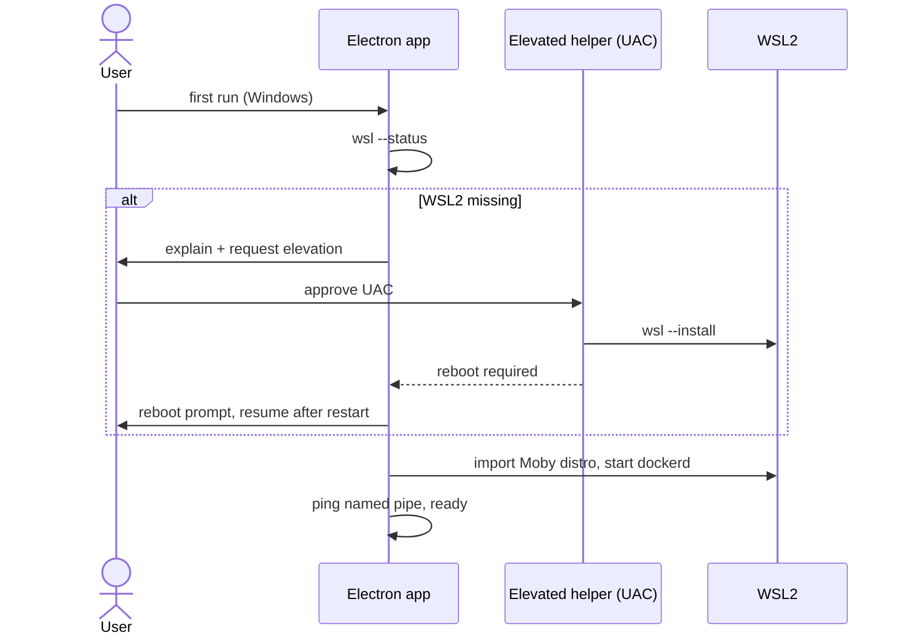
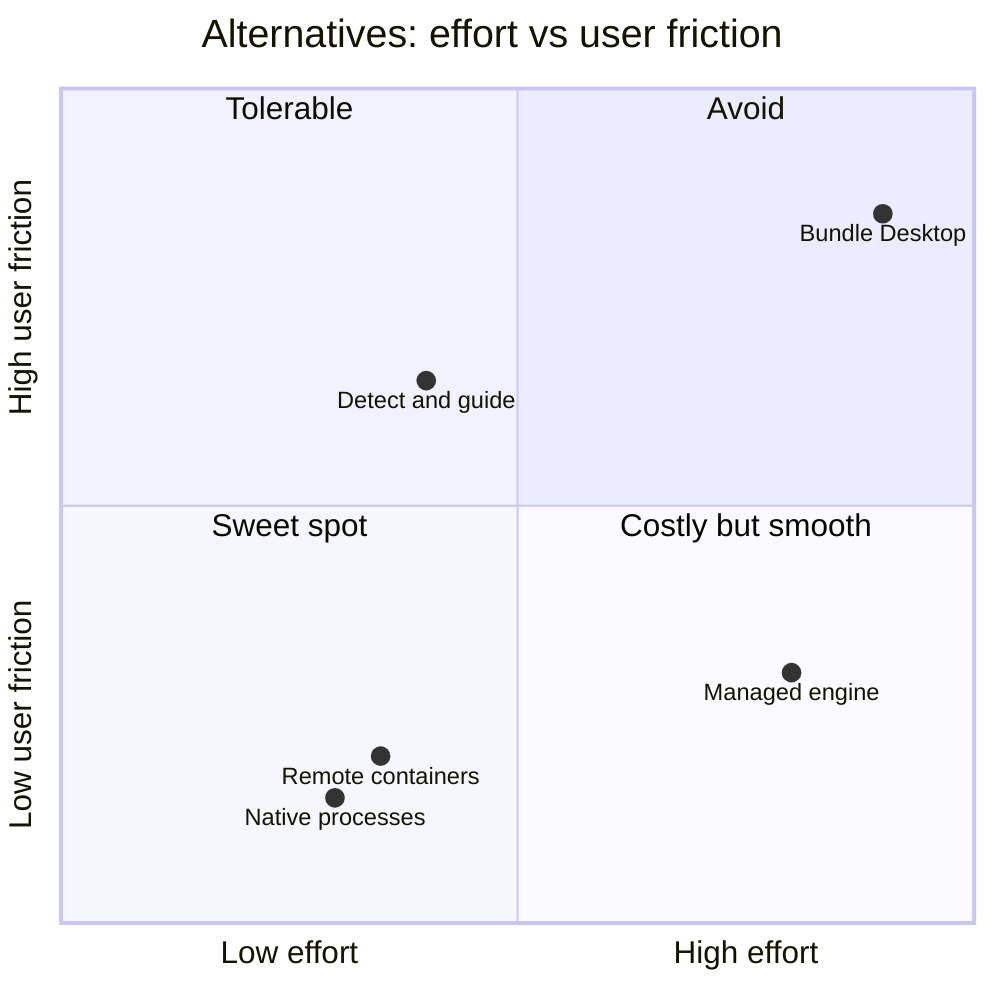

# Electron desktop app + Docker

> [!abstract] TL;DR
> Don't bundle Docker Desktop. Use **dockerode** from the Electron main process against whatever engine is present. **v1** detects an existing engine and guides install. **v2** optionally manages its own engine (Colima/Lima on macOS, WSL2 + Moby or Podman machine on Windows). First settle whether the app needs *local* containers at all.

> [!info] Confidence legend
> `[V]` verified on a primary page fetched during research · `[U]` unverified / from knowledge only.
> Fetched pages were summarized by a fetch tool, so **recheck quotes before legal reliance**.

## Contents

- [[#Decision map]]
- [[#Summary and recommendation]]
- [[#1. Bundling / managing Docker]]
- [[#2. Driving containers from the main process]]
- [[#3. Licensing]]
- [[#4. Installer / distribution]]
- [[#5. Auto-update]]
- [[#6. Alternatives]]
- [[#Open questions]]
- [[#Could not verify]]

---

## Decision map

### Target architecture

---

## Summary and recommendation

1. **Do not bundle or silently install Docker Desktop.** Its subscription agreement bars transferring/distributing "the Services" to third parties; the image-redistribution carve-out does not name Desktop `[V]`. Treat Desktop as bring-your-own: detect it, link to the installer.
2. **Use dockerode (Engine API), not the CLI.** dockerode/docker-modem already pick the right default socket/pipe per platform `[V]`.
3. **Zero-prerequisite route = an engine you manage yourself:** Colima (MIT) or Lima (Apache-2.0) on macOS; Podman machine (Apache-2.0) or a dedicated WSL2 distro running Moby (Apache-2.0) on Windows `[V]`. More engineering and support; the WSL2 path needs admin + reboot `[V]`.
4. **Phasing:**
   - **v1** = detect existing engine (Docker Desktop, Colima, Podman, Rancher) via `DOCKER_HOST`/socket probing + guided install UI.
   - **v2** = optional managed engine.
5. **First question to settle:** does the app really need containers on the user's machine? If the workload is server-ish, a remote backend with a thin Electron client removes all of the above ([[#6. Alternatives]]).
6. **Distribution:** electron-builder or Forge, both fine. macOS needs Developer ID signing + notarization; auto-update on macOS requires a signed app `[V]`. Windows: Azure Artifact Signing (cheapest, country-limited) or cloud-HSM EV cert `[V]`.

---

## 1. Bundling / managing Docker

| Option | Install friction | Admin | Virtualization | License |
|---|---|---|---|---|
| Docker Desktop (user-installed) | Highest for user; large download, account/licensing prompts | mac: default needs no privileged access; Win: per-user install needs no admin, but first-time WSL2 enablement needs admin `[V]` | Win: WSL2 (needs WSL 2.1.5+) or Hyper-V; Pro/Enterprise/Education 22H2/23H2+; hardware virtualization in BIOS; not Windows Server `[V]`. mac: Rosetta 2 recommended, not strictly required `[V]` | Proprietary subscription ([[#3. Licensing]]) |
| Colima (mac) | `brew install` or bundle binaries; needs docker CLI only if you use CLI | none stated | Apple Silicon + Intel; x86 containers on Apple Silicon via `--vm-type=vz --vz-rosetta` (macOS 13+, Colima 0.5.3+) `[V]` | MIT `[V]` |
| Lima (mac/Linux) | Library-style; Colima is built on it | none stated | CNCF incubating; vmType/Rosetta not confirmed on fetched page `[U]` | Apache-2.0 `[V]` |
| Podman machine | Needs a VM on mac and Windows `[V]` | `podman machine` is rootless-only `[V]` | Providers: mac libkrun (default) / applehv; Win wsl (default) / hyperv `[V]` | Apache-2.0 `[V]` |
| Own WSL2 distro + Moby/dockerd | You script `wsl --install` / `--import` | `wsl --install` requires admin PowerShell + reboot `[V]` | Windows 10 2004+ (build 19041) or Win 11 `[V]` | Moby Apache-2.0 `[V]` |

**Sources**
- Docker Desktop Windows reqs/admin: <https://docs.docker.com/desktop/setup/install/windows-install/>
- Docker Desktop Mac reqs/admin: <https://docs.docker.com/desktop/setup/install/mac-install/>
- Colima: <https://github.com/abiosoft/colima>
- Lima: <https://github.com/lima-vm/lima>
- Podman machine: <https://docs.podman.io/en/latest/markdown/podman-machine.1.html>
- WSL install: <https://learn.microsoft.com/en-us/windows/wsl/install>
- Docker states Engine on Windows/macOS comes "through Docker Desktop": <https://docs.docker.com/engine/install/>

> [!warning] Not verified
> Rancher Desktop specifics (not fetched); Apple Silicon behaviour of Docker Desktop's own Rosetta use beyond the above; whether Colima needs any admin rights.

---

## 2. Driving containers from the main process

### dockerode vs CLI

- dockerode is Apache-2.0, talks to the Engine HTTP API; `docker.pull` + `docker.modem.followProgress(stream, onFinished, onProgress)` gives structured pull progress; `container.logs(options)` maps to the ContainerLogs endpoint `[V]` <https://github.com/apocas/dockerode>
- Raw API: `POST /images/create?fromImage=...` streams JSON progress; `GET /containers/{id}/logs`; registry creds go in `X-Registry-Auth` `[V]` <https://docs.docker.com/engine/api/sdk/examples/>
- Pull stream must be read to completion (Go SDK note, same logic applies to any client) `[V]`.
- API versioning: client negotiates highest common version; `DOCKER_API_VERSION` disables negotiation `[V]` <https://docs.docker.com/reference/api/engine/>
- CLI shell-out: no primary source fetched. Trade-off: the CLI may be absent even when an engine exists (e.g. Colima without docker CLI) `[U]`. Recommendation: dockerode primary; CLI only for `docker compose` if needed `[U]`.
- Log demux: dockerode shows `modem.demuxStream` for attach; applying to logs is not stated in the README. Non-TTY log streams are multiplexed in Docker's format `[U]` (confirm in Engine API ContainerLogs spec).

### Socket / pipe locations

| Platform / tool | Default endpoint | Status |
|---|---|---|
| docker-modem, Windows (`DOCKER_HOST` unset) | `//./pipe/docker_engine` | `[V]` |
| docker-modem, mac/Linux | `~/.docker/run/docker.sock` if present, else `/var/run/docker.sock` | `[V]` |
| Docker Desktop mac | `~/.docker/run/docker.sock`; `/var/run/docker.sock` symlink optional; CLI context `desktop-linux` | `[V]` |
| Linux daemon | `/var/run/docker.sock` (root or docker group) | `[V]` |
| Colima / Podman / Rancher | per-tool sockets (e.g. under `~/.colima/...`) | `[U]` |

docker-modem also honors `unix://`, `npipe://`, tcp and ssh.

Sources: <https://raw.githubusercontent.com/apocas/docker-modem/master/lib/modem.js> · <https://docs.docker.com/desktop/setup/install/mac-permission-requirements/> · <https://docs.docker.com/reference/cli/dockerd/>

### Detecting installed / running

Try `GET /_ping` (or `docker.ping()`) on candidate sockets: `DOCKER_HOST`, the docker-modem default, then known per-tool paths. Detection must read `DOCKER_HOST` and `docker context` rather than assume. Specific `_ping` behaviour not re-verified `[U]`.

---

## 3. Licensing

> [!danger] Docker Desktop is not freely redistributable
> Bundling Desktop needs Docker's written permission (Sec. 3.3(a)). Get legal review.

- Docker Desktop is free only for non-commercial open source, or commercial undertakings with **fewer than 250 employees AND less than US$10M annual revenue**; government entities always need paid `[V]` <https://www.docker.com/legal/docker-subscription-service-agreement/> (Sec. 3.2). Summary: <https://docs.docker.com/subscription/desktop-license/>
- Redistribution: Customer may redistribute Docker Images bundled in its own software, not standalone (Sec. 2.1); Sec. 3.3(a) prohibits distributing/transferring "the Services" or making derivative works unless authorized `[V per fetch]`.
- Desktop license page says nothing about redistribution; notes GPL components in Desktop `[V]`.
- Docker Engine / Moby: Apache-2.0 `[V]` <https://github.com/moby/moby/blob/master/LICENSE>
- Colima MIT `[V]`; Lima Apache-2.0 `[V]`; Podman Apache-2.0 `[V]` (links in [[#1. Bundling / managing Docker]]).
- Not verified: license of the docker CLI binary (believed Apache-2.0 `[U]`); Rancher Desktop license `[U]`; each pulled image has its own terms.

> [!tip] Implication
> If end users are employees at 250+ person companies, requiring Docker Desktop pushes a paid cost onto them. A managed Colima / Podman / WSL2+Moby engine avoids that.

---

## 4. Installer / distribution

- **macOS:** apps must be signed and notarized; Apple Developer Program has an annual fee; Xcode needed; Forge/Packager automate signing/notarization; `safeStorage`, `autoUpdater`, login items depend on correct signing `[V]` <https://www.electronjs.org/docs/latest/tutorial/code-signing>
- **Windows:** Azure Artifact Signing is cheapest, removes SmartScreen warnings, limited to certain countries (jsign usable from mac/Linux). Traditional certs: EV required since June 2023 per Electron docs, hardware-stored, so cloud signing (e.g. DigiCert KeyLocker) is common for CI. Forge/Packager use `windowsSign` via `@electron/windows-sign`; electron-builder has its own signing `[V, same page]`. Microsoft EV policy not cross-checked `[U]`.
- **electron-builder macOS:** needs both dmg and zip targets for auto-update `[V via search-result summary]` <https://www.electron.build/docs/features/auto-update/> · <https://www.electron.build/docs/mac/>
- **WSL2 prerequisite flow:** check `wsl --status`; if missing, elevated `wsl --install` then reboot; may hang at 0% → `--web-download` `[V]` <https://learn.microsoft.com/en-us/windows/wsl/install>. Requires hardware virtualization enabled in BIOS `[V]`.
- **Docker Desktop silent-install flags** (`--accept-license`, `--user`, etc.) exist, but don't ship the installer unless Docker authorizes it.
- electron-builder vs Forge: not compared in depth; both support signing and auto-update publishing `[partly V]`.

> [!note] The elevated-helper flow above is a design suggestion `[U]`, not a documented pattern.

---

## 5. Auto-update

- **Electron `autoUpdater`:** macOS (Squirrel.Mac) and Windows only; macOS requires signed app; Windows uses Squirrel.Windows or MSIX updater; Linux unsupported `[V]` <https://www.electronjs.org/docs/latest/api/auto-updater>
- **Hosting options:** static storage (`releases.json` mac / `RELEASES` win, Forge can generate), free update.electronjs.org (public GitHub repo + GitHub Releases + signed on mac), or own server (Hazel, Nuts, electron-release-server, Nucleus, or custom Squirrel-compatible) `[V]` <https://www.electronjs.org/docs/latest/tutorial/updates>
- **electron-updater (electron-builder):** signing required on macOS; zip + dmg targets; optional Ed25519-signed update manifests (opt-in, newer, check your version) `[U]` (direct page fetch 404'd; from search summaries of <https://www.electron.build/docs/features/auto-update/> and <https://www.electron.build/docs/features/signed-update-manifests/>).
- **Signing interaction:** unsigned mac builds cannot auto-update; changing Windows certificate/publisher between releases may affect SmartScreen reputation `[U]`.
- **Managed engine:** updating the app must not restart or delete the VM/WSL distro; version the engine separately `[U]` (design).

---

## 6. Alternatives

> [!note] Chart positions are qualitative judgement, not measured data.

- **Tauri:** system webview, Rust backend, small bundles (minimal app under 600KB claim) `[V]` <https://v2.tauri.app/start/>. Changes the shell, **not** the engine question. Webview variance across OS vs Electron's bundled Chromium `[U]`.
- **No containers (native processes):** eliminates VM prerequisites; signing/update still needed. Feasible only if the workload ships as cross-platform binaries `[U]`.
- **Remote/cloud containers + thin client:** removes local virtualization/admin/license issues; adds hosting cost, auth, latency, offline loss `[U]`.
- **Dev Containers:** spec adds dev metadata to existing container formats via `devcontainer.json`; page does not state Docker is required `[V]` <https://containers.dev/overview>. Relevant mainly if the app is a dev tool; supplies no engine.
- **Not investigated:** WebAssembly/WASI runtimes, Apple's `container` tooling, Firecracker-like microVMs `[U]`.

---

## Open questions

- [ ] What is the workload (user-facing images? dev environments? databases)? Determines whether local containers are needed at all.
- [ ] Target users: consumers vs enterprise? Enterprise often already has Docker Desktop/Rancher and may forbid unmanaged VMs.
- [ ] Windows containers (needs Pro/Enterprise + Hyper-V) or Linux only? Assume Linux only.
- [ ] Exact socket paths for Colima/Podman/Rancher; verify against their docs.
- [ ] Would Docker grant written permission to bundle Desktop? (contact Docker sales/legal)
- [ ] Apple Silicon: do any required images lack arm64, forcing Rosetta/QEMU emulation?
- [ ] Windows signing eligibility for Azure Artifact Signing (org country/age requirements).
- [ ] electron-builder vs Forge final choice; exact current electron-updater signing requirements (read direct docs, two URLs 404'd).

## Could not verify

- Rancher Desktop details
- docker CLI license
- Colima / Podman default socket paths
- `_ping` semantics
- Lima vz/Rosetta
- Direct electron-builder auto-update page text
- Microsoft EV certificate policy
- Docker Desktop on Windows named-pipe name (Desktop docs only mention `dockerBackendV2`; `docker_engine` comes from docker-modem source)
